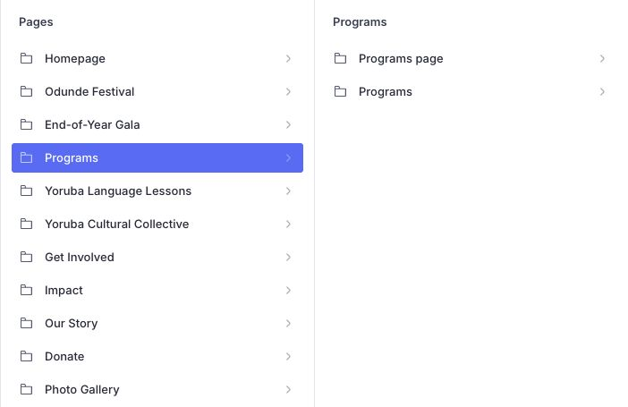
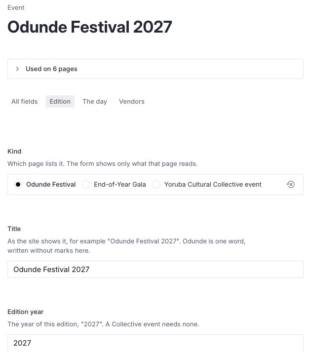
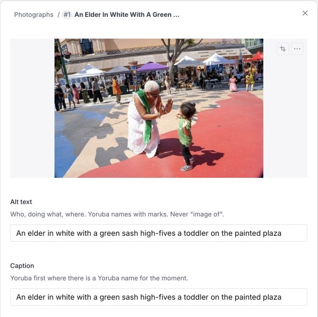
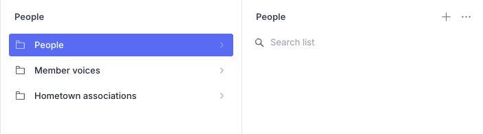

# How to update our website

Ẹ káàbọ̀, welcome. This guide shows you, one step at a time, how to add and change
what is on our website.

Take your time. Looking around changes nothing, and visitors see nothing you type
until you press **Publish**.

Words in **bold** are words you will see on the screen. The pictures are
examples, so your lists may look a little different.

You can open this guide at any time from the **Member guide** tab at the top of
Studio. To keep it beside you while you work, or to print it,
<a href="/member-guide" target="_blank" rel="noopener">open this guide in its own browser tab</a>.

## Before you start

Studio is the private part of our website. It holds the words, photographs and
event details that visitors see. Only people we have invited can open it.

1. Open Studio at
   <a href="https://www.omoyorubasocal.org/admin" target="_blank" rel="noopener">omoyorubasocal.org/admin</a>.
   It opens in a new browser tab.
2. Sign in the same way you did when you accepted your invitation: with
   **Google**, or with **E-mail / password**.
3. If you cannot sign in, ask an administrator.

An administrator is one of the people who look after the website for us. If you
do not know who that is, ask the person who invited you to Studio.

Three things to know before you change anything:

- Studio saves your work for you as you type. There is no Save button. Wait a
  moment after you stop typing before you close the page.
- Your work is kept as a draft. A draft is a working copy that only people signed
  in to Studio can see.
- Visitors see your work only after you press **Publish**.

## Find your way around

When Studio opens, this is what you see:

- Across the top are three tabs. **Structure** is where you make changes.
  **Presentation** shows how a page will look. **Member guide** is this guide.
- On the left is the menu: **Missing content**, **Events**, **Photos**, **People**
  and **Pages**.
- Each choice in the menu opens a list beside it. Keep choosing until a form
  opens.
- The form is where you type. The small grey words under a box's name tell you
  what to write there. Some forms have tabs of their own near the top, such as
  **Content** and **Advanced**.
- **Publish** is at the bottom right of the form. The three dots beside it open
  a short list of other things you can do.

To find something by name, press the magnifying glass at the top and type the
name. Do this before you add a person or an album, so nothing is entered twice.

### Where to find things

- The words or photographs on a page: **Pages**, then the page.
- The date, time or place of the festival or the Gala: **Events**, then the
  event, then **Editions**, then the year. An edition is one year of an event.
- Gala ticket prices: the Gala's year, then **Ticket tiers**.
- The festival's zones: **Events**, then **Odunde Festival**, then
  **Festival zones**.
- A Collective event: **Events**, then **Yoruba Cultural Collective events**.
- Photo albums and videos: **Photos**, then **Albums**.
- The board, staff and volunteers: **People**, then **People**.
- Quotes from our members: **People**, then **Member voices**.
- Our programs, with their photographs and details: **Pages**, then
  **Programs**, then **Programs**.
- The ways to get involved: **Pages**, then **Get Involved**, then
  **Ways to get involved**.
- Partners and funders: **Pages**, then **Impact**, then **Partners**.
- Anything the website marks as Pending, its label for a fact we have not given
  it yet: **Missing content**.

## Change the words on a page

1. Open **Pages** and choose the page, for example **Our Story**.
2. **Programs**, **Get Involved** and **Impact** open a short list first. Choose
   the entry that ends in **page**, for example **Programs page**.
3. The form opens on **Content**. Find the box you want and type your change.
4. To change the page's main heading, open **Heading and kicker** near the top.
   The kicker is the small line in capitals above the heading, in Yoruba and
   English.
5. Check your work and publish it. The steps are under
   [Check your work and publish](#check-your-work-and-publish).

<figure>

<figcaption>Programs opens a short list. Programs page holds the page's words. Programs holds each program.</figcaption>
</figure>

<aside>

Good to know

- **Advanced**, beside **Content**, holds what we rarely change: short
  introductions to some sections, switches that show or hide a section, and the
  title that search engines show. You can leave it alone.
- On the homepage, the heading, the line under it and the main photograph are
  under **Hero**. Its buttons are there too, under
  **Campaign buttons and decoration**.
- On every other page, the buttons at the top are built into the website. So is
  the way each page is laid out. To change one, ask an administrator.
- The festival and Gala pages do not hold the date, time, place or tickets. Those
  belong to that year's edition. See
  [Add or change an event](#add-or-change-an-event).
- On the **Yoruba Language Lessons** page, **Lesson details** has a box each for
  the format, when, ages and cost. On the **Donate** page, **Donation form
  details** works the same way. Fill in only what is confirmed.
  **Additional notes (optional)** is there if a detail needs a few more words.

</aside>

### Change a photograph

1. Find the photograph in the form. It may be called **Photo** or
   **Photo band image**.
2. If the box is empty, press **Upload** and pick the photograph from your
   computer.
3. To replace a photograph that is already there, press the three dots at its
   top right, then choose **Upload**.
4. Fill in **Alt text**: one plain sentence saying who is in the photograph,
   what they are doing and where. People who cannot see the photograph hear this
   sentence read aloud.
5. Fill in **Caption** if you want a line of words shown with the photograph.
6. To choose which part always shows, press the crop button, beside the three
   dots. Then move the circle onto the faces.

The picture under [Add photographs or a video](#add-photographs-or-a-video)
shows these boxes and buttons.

Use only photographs we have permission to publish. Take extra care with
photographs of children.

### Change the ways to take part

Several pages end with a band of ways to take part: volunteer, sponsor, give and
so on. In the form it is called **Take-part band**.

1. Open a row, or press **Add item** for a new one.
2. Choose its **Way in**. The website supplies the row's title and its button.
3. Write its **One line**: a sentence saying what we are asking of the reader.
4. Open **Custom wording (optional)** only if this page needs different words.

Each way in can be used once on a page.

## Add or change an event

Each year of the festival or the Gala is called an edition: Odunde Festival
2027, End-of-Year Gala 2026. Everything that changes from year to year is kept
on the edition.

### Change this year's details

1. Open **Events**.
2. Choose **Odunde Festival** or **End-of-Year Gala**.
3. Choose **Editions**, then the year.
4. Choose **Edition details**.
5. Change what you need: **Starts**, **Ends**, **Venue**, **Summary**. The
   festival also has **Cost**. The Gala also has **Doors**, **Dress** and
   **Tickets link**. Times are Los Angeles time.
6. For the running order, open the tab called **The day**. The festival's booth
   fees and dates are under **Vendors**.
7. Check your work and publish it.

Beside **Edition details** you will find that year's **Albums**. A Gala year
also has its **Ticket tiers** and **Honorees** there.

<figure>

<figcaption>A festival edition's form. The tabs near the top are All fields, Edition, The day and Vendors.</figcaption>
</figure>

### Add next year's edition

1. Open **Events**, then the event, then **Editions**.
2. Press the **+** button at the top right of the list.
3. Type the **Title**, for example Odunde Festival 2027.
4. Type the **Edition year**.
5. Fill in what is confirmed. Leave the rest empty.
6. Leave it as a draft until the day we agree to announce it. Then press
   **Publish**. Studio does not publish on a set date by itself.

### Gala tickets and honorees

1. Open **Events**, then **End-of-Year Gala**, then **Editions**, then the year.
2. Choose **Ticket tiers** or **Honorees**.
3. Choose one to change it. To add one, press the **+** button at the top right
   of the list.
4. For a new one, check that **Edition** shows the right year.
5. Check your work and publish it.

<aside>

Good to know

- A ticket tier is one kind of ticket, with its **Name**, its **Price** and what
  it **Includes**.
- The price here is only what the website shows. Tickets are sold through
  Zeffy, the service that takes our payments, and Zeffy charges the price set
  there. When a price changes, change it in Zeffy first, then make this one
  match.
- Honorees appear on the website only after an administrator turns the awards
  on.
- **Sponsor levels** are in their own list, beside **Editions**.

</aside>

### Add a Collective event

1. Open **Events**, then **Yoruba Cultural Collective events**.
2. Press the **+** button at the top right of the list.
3. Fill in the **Title**, **Starts**, the venue's **Name** and a **Summary**.
4. Check your work and publish it.

The event shows on the Collective's page once it has a start date, and until
that day has passed.

## Add photographs or a video

Photographs and videos are kept in albums. Visitors see the albums in our Photo
Gallery. The festival and Gala pages also show photographs from their most
recent past year.

### Start a new album

1. Open **Photos**, then **Albums**.
2. Press the **+** button at the top right of the list.
3. Type the **Title**.
4. Press **Generate** beside **Web address**. Do this once.
5. Under **Edition**, choose the event and year the photographs come from. This
   is what puts them on that event's page.
6. Fill in **Date** if the photographs come from no event, or if the exact day
   matters.
7. Under **Photographer**, choose who took them.
8. Turn on **Credit confirmed** only when the photographer has agreed to the
   credit. If you are not sure, leave it off and ask an administrator.
9. Use **Consent note** for anything special about permission for this album.

<aside>

Good to know

- If the photographer's name is not in the list, add it first. Open **Photos**,
  then **Photographers**, press the **+** button, fill in the name and publish
  it.
- Never change the **Web address** of an album that is already on the website,
  because people may have shared its link.
- An album appears in the gallery once it has a web address and at least one
  photograph.

</aside>

### Add photographs to an album

1. Open **Photos**, then **Albums**, then the album.
2. Under **Photographs**, press **Add item**.
3. Press **Upload** and pick the photograph from your computer.
4. Fill in its **Alt text**.
5. Fill in its **Caption**.
6. Close the photograph with the × at its top right. Do the same for the next
   one.
7. To change the order, drag a photograph by the handle on its left.
8. Check your work and publish it.

<figure>

<figcaption>A photograph, opened. The crop button and the three dots are at its top right. Alt text and Caption are below. Photograph: Red Carpet Films.</figcaption>
</figure>

<aside>

Good to know

- The first photograph is the album's cover: the one the gallery shows for the
  album. To use a different one, add it under **Cover**.
- To correct a photograph that is already in an album, open it and change it
  there. Do not remove it and add it again, because that breaks links people
  have shared.
- Open **Different credit for this photograph** only when one photograph was
  taken by someone else.
- Use only photographs we have permission to publish. Take extra care with
  photographs of children. If you are not sure, leave the album as a draft and
  ask.

</aside>

### Add a video

1. Open **Photos**, then **Albums**, then the album.
2. Under **Videos**, press **Add item**.
3. Type a **Title**.
4. On YouTube, press **Share** under the video and copy the address it gives.
5. Paste the address into **YouTube address**.
6. Check your work and publish it.

Videos show above the album's photographs. The album's festival or Gala page
also shows its first video, so put the best one first.

**Still** is the picture shown before the video plays. Leave it empty to use the
album's cover. **Made by** names whoever made the video. Both are optional.
Nothing loads from YouTube until a visitor presses play.

## Add or change a person

1. Open **People**, then **People**.
2. Choose the person to change. To add someone new, press the **+** button at
   the top right of the list.
3. Fill in their **Name** and their **Role**, for example Chair.
4. Choose their **Group**: **Board**, **Staff** or **Volunteers**. Our Story
   lists people by group.
5. Write a **Short bio**.
6. A **Portrait** is optional. Add one only if the person agrees, and fill in
   its alt text.
7. To move someone up their group's list, give them a lower number in
   **Order**.
8. Check your work and publish it.

<figure>

<figcaption>The + button is at the top right of the list.</figcaption>
</figure>

Our Yoruba Language Lessons teacher is set up differently. Leave the teacher's
**Group** empty. Then open **Pages**, then **Yoruba Language Lessons**, and
choose the teacher under **Teacher**.

## Add to another list

Member voices, partners, festival zones and the other lists all work the same
way.

1. Open the list. [Where to find things](#where-to-find-things) shows where
   each one is.
2. Press the **+** button at the top right of the list.
3. Fill in the boxes. The small grey words under each name say what to write.
4. Check your work and publish it.

For a member's quote, turn on **Permission to name** only if the person has
agreed to be named. While it is off, the website shows their initials.

## Fill in what is missing

**Missing content** is our to-do list. It finds every place where the website is
still waiting for a fact, and shows them together.

1. Open **Missing content**, at the top of the menu on the left.
2. To see one page only, choose it under **Page**.
3. Each item in the list is one thing to finish. Press the line that says how
   many details are missing to see what it still needs.
4. Press the item's name to open it, and fill in what is confirmed.
5. Check your work and publish it.

<aside>

Good to know

- What the next festival and Gala need comes first, under
  **Next event essentials**.
- An item leaves the list as soon as its draft has the details. That does not
  mean it is on the website. You still need to publish it.
- **Owner decisions and items to add** lists what still needs a decision from
  our leaders, or a new entry such as a member's quote. Add an entry only when
  its facts are confirmed.
- **Wording to check**, at the bottom, appears when published words have a long
  dash or a Yoruba word without its marks. Open it to see what to correct.

</aside>

## Check your work and publish

1. Read your work once more. The checklist below helps.
2. Press the line that begins **Used on**, above the form, then choose a page.
   The page opens beside your form, with your changes in it.
3. To see the page as a phone shows it, press the phone button above the page.
4. Press **Publish**, at the bottom right.
5. Open our website and look at the page. A change can take a minute to appear.

Before you publish, check that:

- Every fact is confirmed. If we do not know a date, a price or a name yet,
  leave the box empty. The website shows a small Pending label there until we
  know.
- Yoruba words and names have their marks, as in Ẹ káàbọ̀ and Ọjà Balógun. If you
  cannot type a mark, copy the word from a place where it is already written
  correctly, or ask.
- Odunde is one word, written without marks. Our lessons are called Yoruba
  Language Lessons.
- There is no long dash. Use a comma, a colon or a new sentence. Studio will not
  publish words that contain one.
- Headings have a capital letter on the first word and on names only.
- Every photograph has its alt text.

A red warning beside a box means it must be put right before Studio will
publish. A yellow one is advice.

## If something does not look right

### Publish is grey

Either there is nothing new to publish, or a box has a red warning. Put that box
right and try again.

### Your change is not on the website

Check that you pressed **Publish**. Wait a minute, then load the page again.

### You changed the wrong thing

Press the three dots beside **Publish** and choose **Discard changes**. The form
goes back to what is on the website. This undoes everything changed in that form
since it was last published.

### A box is grey and you cannot type in it

It belongs to an administrator. Ask one to change it.

### Studio says your changes are not saving

Check your internet connection and keep the page open. Studio keeps trying.

### Studio asks you to sign in again

Sign in as before. Your drafts are safe.

## When to ask an administrator

Ask an administrator when:

- you cannot sign in
- something needs to come off the website, for example a photograph someone
  has asked us to remove
- a box you need is locked
- your change is still not on the website after a few minutes
- you are not sure a fact is confirmed, or that we have permission for a
  photograph

Tell them which page you were on, and copy any message you saw.

If you ever come across a visitor's message or email address in Studio, keep it
private.

## For administrators

This part is for administrators. Members do not see **Inbox** or
**Organization details**, and the switches below are locked for them.

### Messages from the website

Messages sent through the website's own forms arrive in **Inbox**. Donations,
tickets and paid memberships go to Zeffy instead.

1. Open **Inbox**, then **New**, then the message.
2. When you take it on, press the three dots at the bottom right and choose
   **Start handling**. The message moves to **In progress**.
3. To answer, press the address beside **Reply to**. Your own email opens.
   Replies are not kept in Studio.
4. In **Notes**, write who is dealing with it and what happens next. Notes save
   by themselves.
5. Press **Mark handled** when it is done. **Move to new** opens it again.

None of these steps needs **Publish**, and none sends another email.

- Each new message is also emailed to us. **Not emailed** lists the messages
  whose email has not gone out. Open one to read the problem. Once the cause is
  put right, choose **Retry email notification**. If the message is more than a
  day old, look in Resend, our mail service, first, so the same email is not
  sent twice.
- **Email accepted** means the mail service took the email. To be sure it
  arrived, look in Resend.
- **Subscribers** keeps the addresses of people who asked for our newsletter.
  Studio does not send newsletters.

### Switches only administrators change

Each is on its page's form, under **Advanced**, then **Sections and promotion**.

- **Photo Gallery**, **Albums**. **Coming soon** takes every album's
  photographs and videos off the website, on the festival and Gala pages too.
  Photographs placed directly on a page stay.
- **Our Story**, **Timeline**. Shows or hides the timeline.
- **End-of-Year Gala**, **Awards**. Shows or hides the honorees.

### Organization details

**Organization details** holds our name, EIN, address, phone and email, who
receives each kind of message, the footer, and the addresses of our Zeffy
donation and membership forms.

## Words Studio uses

- Studio: the private part of our website, where we make changes.
- Administrator: one of the people who look after the website. An
  administrator can change everything in Studio.
- Draft: your changes before they are published. Only people signed in to
  Studio can see a draft.
- Publish: put your changes on the website for everyone to see.
- Edition: one year of the festival or the Gala.
- Alt text: a sentence describing a photograph, for people who cannot see it.
- Caption: the line of words shown with a photograph.
- Kicker: the small line in capitals above a heading, Yoruba first, then
  English.
- Pending: the label the website shows where a fact is still missing.
- Web address: the end of a page's link, made from its title.
- Way in: one way a visitor can take part, such as volunteering or giving.
- Zeffy: the service that takes payments for our tickets, donations and
  memberships.
