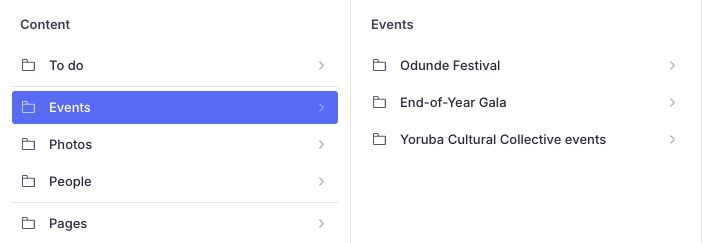
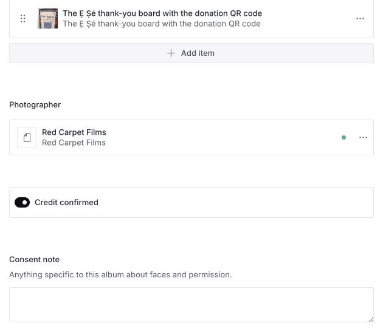
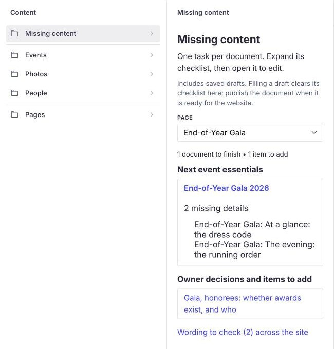
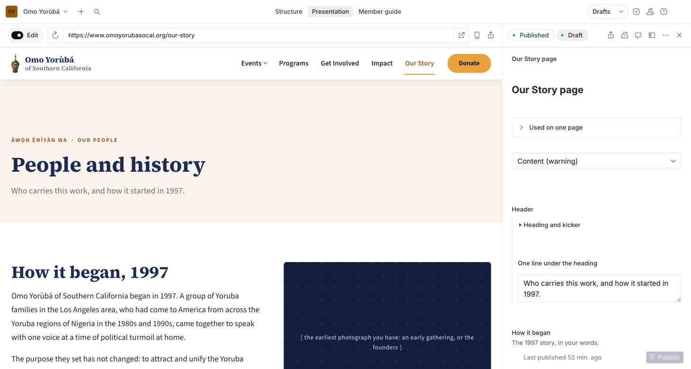

# Your guide to Studio

Welcome! Studio is where we keep our website up to date. Ask an administrator
whenever you are unsure.

Find this guide in the **Member guide** tab at the top of Studio.

## Get started

Open <a href="https://www.omoyorubasocal.org/admin" target="_blank" rel="noopener">Studio</a> and sign in with your
invited account. Ask your administrator if you cannot sign in.

Search before adding something new to avoid duplicates. Changes save as a
**draft** while you work. **Publish** makes them available on the website. Leave
unfinished work as a draft, and wait for saving to finish before closing.

The screenshots show example items. Your lists and details may differ.

Choose a section on the left, then the list you need beside it.

## Edit a page

Open **Pages** and choose the page you want. Programs, Get Involved and Impact
open another list: choose the entry ending in **page** for the page's text, or
one of the lists beside it for its programs, ways to get involved or partners.

Choose **Programs page** to edit the page's text, or **Programs** to edit its list.

Start in **Content** for the copy, photographs and lists you change regularly.
**Advanced** holds supporting introductions, search and sharing overrides, and
section or promotion switches. Heading and kicker fields are collapsed in the
header. Layout styles and ordinary page buttons are supplied by the website.

On the Gala page, the header photograph and evening description are in Content.
Dates, venue and the ticket form belong to its edition. Supporting introductions
are optional overrides in Advanced.

For a take-part row, choose its **Way in** and write its descriptive line. The
website supplies the title and button wording. Open **Custom wording** only to
change those words. Lessons and Donate have named detail inputs: enter confirmed
values and leave anything unknown empty. Additional notes are optional.

## Add an event

1. Open **Events**. For the festival or Gala, choose its name, then **Editions**.
   For the Collective, choose **Yoruba Cultural Collective events**.
2. Start a new item. Add the title, dates, venue and summary. Festival and Gala
   editions also need an **Edition year**. Times are in Los Angeles time.
3. Open **Edition details** to edit an existing festival or Gala edition. Its
   **Albums** list shows photographs and videos for that edition. A Gala edition
   also has **Ticket tiers** and **Honorees**. New items in these lists already
   name the correct edition; check it before publishing. Sponsor levels remain
   in their own list beside Editions.
4. Keep the event as a draft until its agreed announcement day, then **Publish**.
   Publishing is manual; it is not scheduled for you.

A Collective event needs a start date to appear on the site.

The tabs group an edition's details. Start with its title and year.

## Add an album

1. Open **Photos → Albums** and start a new album. Add its **Title**, then
   generate the **Web address** once. Keep an existing album's address unchanged.
2. Choose the matching **Edition** for event photographs. Add a confirmed
   **Date** when there is no edition or the exact day matters.
3. Choose **Add item** under **Photographs** to add a photograph. Keep them in
   the order you want them shown. Give each one **Alt text** describing who is
   doing what and where, plus a **Caption**.
   The first photograph is the cover unless you choose another **Cover**.
4. To add a video, choose **Add item** under **Videos**. Give it a **Title**
   and paste the **YouTube address** that the video's Share button gives. A
   **Still** and **Made by** are optional: without a still, the album's cover
   or first photograph shows under the play mark. Videos appear above the
   photographs, and the first two also appear on the event's page. Nothing
   loads from YouTube until a visitor presses play.
5. At the top of the album, choose the **Photographer**. Tick **Credit confirmed** only once the owner
   confirms the credit. Add a **Consent note** for permission specific to this
   album. Check it, then **Publish**.

Add item sits below the photographs. The current form puts album credit and
permission before the photographs; this screenshot shows the earlier order.
Open **Different credit for this photograph** only when one photograph needs
an exception to the album's credit.

Use only photographs the organization has permission to publish, including for
children shown. If unsure, keep a draft and ask. An album needs a photograph to
appear in the gallery.

Edit existing photographs in place. Removing and adding one again can break
shared links.

Open a photograph to add alt text and a caption. Photograph: Red Carpet Films.

## Add a person

1. Open **People → People**. Use the create button at the top right of the list.
2. Add their **Name**, **Role** and **Short bio**. Choose the right **Group**:
   board, staff or volunteers. This lets Our Story list them.
3. A portrait is optional. If you add one, confirm permission and include alt
   text and a caption.
4. Check their details and choose **Publish**.

For the Language Lessons teacher, leave **Group** empty and select that person
under **Pages → Yoruba Language Lessons → Teacher**.

Use the create button at the top right, beside the menu.

## Finish missing content

1. Open **Missing content**. Choose a page to focus the list.
2. Expand a document's missing details, then open its title to edit it.
3. Fill in confirmed information, check it and **Publish** when ready.

Each document appears once, with its missing fields together. The next festival
and Gala essentials come first. Other site content follows, then owner decisions
and items to add. **Wording to check** holds text corrections across the site.

The checklist includes saved drafts. A task disappearing means its draft has
the details, not that the changes are published. Check the public page too.

## Manage messages in the Inbox

Administrators can open **Inbox → New** to read website enquiries. Open the
document actions menu at the bottom right. **Start handling** moves a message
to **In progress**. Use the **Reply to** email link to open your
email app, and add a note naming who is handling it and the next step. Notes save
automatically. Choose **Mark handled** when finished, or **Move to new** to reopen
it. These actions do not send another notification.

**Not emailed** lists enquiries without an email receipt. Open one to see any
problem. After fixing its cause, choose **Retry email notification** from the
document actions. An old uncertain result needs a check in Resend first to avoid
sending twice. **Email accepted** means Resend accepted it; check Resend for final
delivery if needed. Replies happen in your email app and are not copied into CMS
notes automatically.

**Subscribers** keeps newsletter sign-ups. It does not send newsletters. The
live CMS has no Vision tab; it was a developer query tool, not an editing step.

## Before you publish

Use confirmed facts and short sentences. Keep the marks on Yorùbá words and
names. Leave unknown details empty; if a required detail is missing, keep a
draft. Fix field errors and ask about warnings you do not understand.

To preview the page you are editing, open the **Used on** row above the fields and
choose a page link. This opens **Presentation**. Use the viewport button to
check a narrow screen too. When ready, choose **Publish** at the bottom right,
then check the public website.

The preview sits beside the form. This example has no changes to publish, so
the Publish button is dimmed. <a href="screenshots/member-guide/preview-and-publish.jpg" target="_blank" rel="noopener">Open the larger image in a new tab</a>.

## When to ask for help

Ask an administrator about locked fields, removing or unpublishing an item, or
changes still missing after a minute. Include the page name and any message.

Administrators handle **Organization details**, the **Inbox**, and the switches
for gallery visibility, Our Story's timeline and Gala awards. **Coming soon**
hides album photographs and videos, including on event pages, but leaves
photographs added directly to pages. Tell an administrator which pages need attention if
permission changes.

Your account may still access enquiries and subscriber details outside these
menus. Keep that information private; share it only with those responsible for
handling it.
