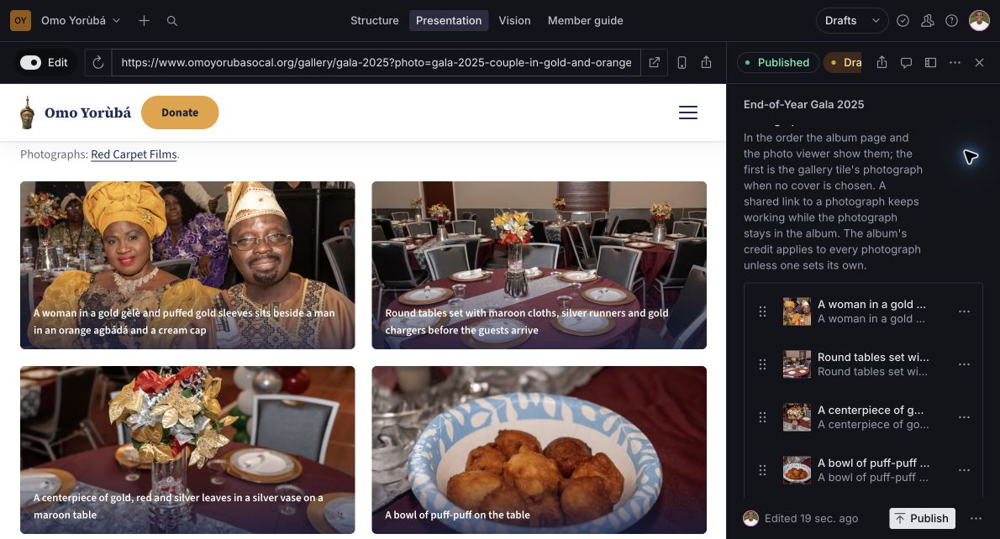
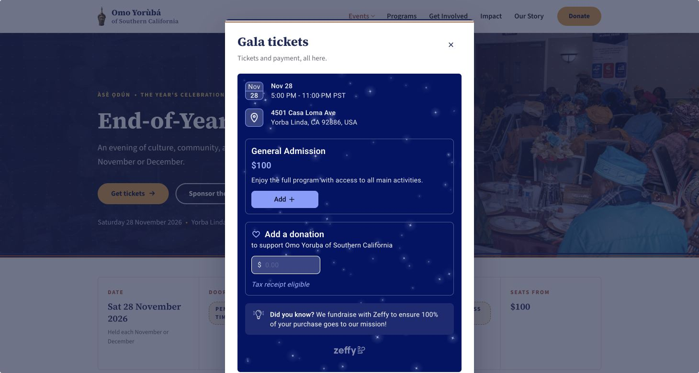
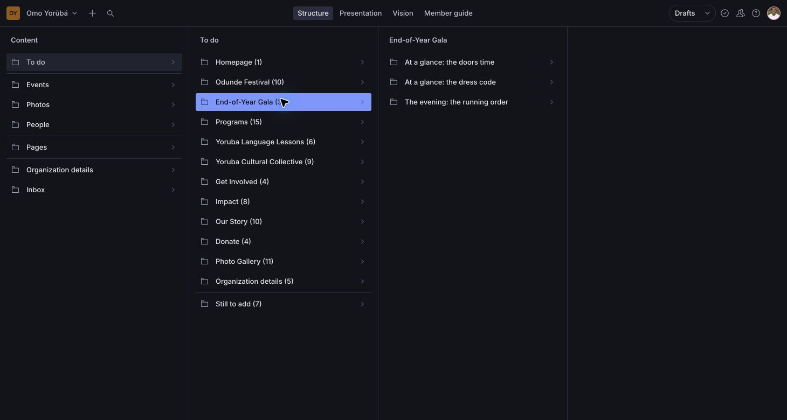

# CMS walkthrough and next improvements

Checked on 11 October 2026 in the signed-in administrator account at
[the website CMS](https://www.omoyorubasocal.org/admin).

Gala page copy, ticket display pricing and an album photo caption all saved as
drafts and appeared in Presentation. Every test edit was restored. No published
document changed, and the existing Gala 2025 album draft was preserved.

## Editing checks

| Task | Where to edit | What passed |
| --- | --- | --- |
| Gala page copy | Pages → End-of-Year Gala → Content | A punctuation-only introduction edit autosaved and appeared in Presentation. Content is the default tab; Advanced holds supporting settings. The temporary draft was discarded after restoring the text. |
| Gala date, venue and ticket link | Events → End-of-Year Gala → Editions → End-of-Year Gala 2026 → Edition details | The signed-in form shows the confirmed date, 5pm to 11pm Los Angeles time, venue and Zeffy embed link. Doors time and dress remain empty. These facts were inspected without changing them. |
| Ticket display price | The same edition → Ticket tiers → General admission | Changing the draft display from `$100` to `$100.00` autosaved and reached the page preview. The value was restored and the temporary draft discarded. Published pricing remained `$100`. |
| Photo caption | Photos → Albums → End-of-Year Gala 2025 → Photographs → a photograph | Adding a final period to the first caption autosaved and appeared in the preview photo viewer. Restoring the caption preserved the original photo key, asset, order and all 53 photos in the existing draft. |
| Photo framing | The photograph → Open image edit dialog | The image, hotspot and crop controls rendered. No crop was changed and no new file was uploaded. |

The Gala 2025 album already had **53 draft photographs and 35 published
photographs** before this walkthrough. All 53 draft photos have alt text and
captions. Publishing that album would publish the existing draft's other changes
too, so review it as a whole before choosing Publish.

Sanity controls the price displayed on the website. **Zeffy controls the amount
charged, ticket availability, orders and payment receipts.** There is no automatic
price synchronization. Update Zeffy first when the real price changes, then match
the website's Ticket tier and preview it.

The live website's Tickets Dialog was also checked: Zeffy loaded General
Admission at **$100**, with 28 November, 5pm to 11pm PST and the Yorba Linda venue.
No ticket was added and no payment information was entered.

For normal content work, edits autosave as drafts. Open **Used on** and choose the
page to preview it. Choose **Publish** when the whole document is ready, then check
the public page. This walkthrough tested draft saving, previewing and restoration;
it did not publish test content or place an order. A separate non-administrator
Editor-account walkthrough remains untested.

## Vision

Vision is a developer tool for testing database queries and inspecting their
results. It does not edit content, render the website or provide the visual page
preview. Sanity's [Vision documentation](https://www.sanity.io/docs/content-lake/the-vision-plugin)
describes its query-only role.

The current Studio shows it to administrators and hides it from member Editors.
It is unnecessary for everyday editing. My recommendation is to expose Vision
only during local development and keep **Structure**, **Presentation** and
**Member guide** in the live CMS. Presentation is the useful preview tool.

## Form submissions and replies

| Submission | Where it goes | How it is managed |
| --- | --- | --- |
| Contact, sponsor, performer, Gala table, membership enquiry, volunteer, lesson or vendor form | Sanity Inbox | An administrator reviews it, replies by email, adds Notes, ticks Handled and publishes that status change. There is no send-reply control in the CMS. |
| Newsletter signup | Inbox → Subscribers | The address is stored. The site has no connected newsletter sending workflow; addresses must be moved to the chosen provider and marked Exported. |
| Zeffy ticket, donation or paid membership form | Zeffy | Manage payments, purchases and those form records in Zeffy. They do not automatically become Sanity enquiries. |

The owned enquiry flow is:

1. The visitor submits a form. The server validates it and applies spam and rate
   checks.
2. Sanity saves the enquiry. The visitor sees the success message at this point.
3. The intended `enquiry-notify` function emails the relevant organization contact
   through Resend. The visitor's email becomes Reply-To, so the recipient can
   answer from their normal mailbox.
4. An administrator records progress in Notes and marks the enquiry Handled.

**Step 3 is not deployed.** Read-only CLI checks returned no Blueprint stacks in
either this project's scope or its organization, including project stacks. The
four existing enquiries have no notification result. Their Inbox names identify
them as earlier automated test submissions, so they are not evidence of four
unanswered visitor enquiries.

All eight specific routing contacts have empty emails and response-time lines.
The configured fallback is `info@omoyorubaofsocal.org`. A shared inbox is a
reasonable starting point, provided someone owns it and checks the CMS Inbox
until notifications are deployed and tested.

`Email sent` currently means Resend accepted a send, not that the message was
delivered or answered. The function is triggered by creation only; editing a
routing contact does not resend an older enquiry. No automatic visitor
acknowledgement is implemented.

Priorities for this workflow:

1. Deploy and configure the notification function, verify the sender domain and
   routing mailbox, then perform an explicitly authorized test delivery. Do not
   automatically replay old test records.
2. Put New, In progress and Handled status, notes, reply address and notification
   status at the top. Add a direct Mark handled action, avoiding a content-style
   Publish step for operational status.
3. Add a visible failed-notification queue and a deliberate retry action. Keep
   message ownership clear if several people handle the inbox.
4. Make success messages say the request was received. The current table, sponsor
   and membership wording promises a held table, an incoming deck or membership
   before a person or downstream system has confirmed those outcomes.

Both Sanity datasets are private, as confirmed by the connector. The current
Studio hides the Inbox from member Editors, but their underlying Sanity role can
still access its records through the API. If editors should not have access to
enquiry or subscriber data, that needs separate permissions or an administrator-only
dataset. Hiding a menu does not provide that boundary; see
[ADR 0042](../adr/0042-the-studio-follows-the-site.md).

## Why so many To do folders remain

They are generated views of missing content. They are not duplicate pages or
unfinished engineering tasks. The simplification reduced editing controls; it
did not supply facts that the organization has not confirmed.

The signed-in view currently shows **12 groups containing 86 missing-field
matches**, plus **7 Still to add categories**. A document missing three facts
counts three times, so the total is not a count of pages or unique documents.

| Group | Current count |
| --- | ---: |
| Homepage | 1 |
| Odunde Festival | 10 |
| End-of-Year Gala | 3 |
| Programs | 15 |
| Yoruba Language Lessons | 6 |
| Yoruba Cultural Collective | 9 |
| Get Involved | 4 |
| Impact | 8 |
| Our Story | 10 |
| Donate | 4 |
| Photo Gallery | 11 |
| Organization details | 5 |

The **Gala's three** are doors-opening time, dress code and running order. Ticket
pricing and the ticket link no longer appear as missing. Honoree and recognition
details are a separate Still to add item.

The **gallery's eleven** are ten albums with photographer credit still to confirm,
plus the summer camp's year. These are factual confirmations, not requests to
rewrite every photo caption.

Still to add also asks for the remaining festival zones, member voices, staff or
volunteer profiles, annual-report and audit positions, and upcoming Collective
events. Some are owner decisions; the current interface gives them the same visual
weight as missing facts for an imminent event.

The counts read **drafts**. A filled draft can clear a To do row while the public
page still shows Pending until publication. The Wording to check list is also
powered by an undeployed function, so its absence does not certify clean copy.

I recommend renaming this view **Missing content**, presenting one list with a
page filter, and separating **Current event essentials**, **Other site content**
and **Owner decisions**. Group several missing fields on one document into a
single task, such as “Finish Gala 2026 details.” Preserve the detailed checklist
inside it. This would reduce navigation without hiding unresolved facts.

## Evidence and limits

The checks used the deployed Studio, Presentation, the Sanity MCP's raw and
draft perspectives, and the repository's own `todoPlan`, `todoQuery` and
`todoState` functions. The resulting counts matched the signed-in UI.

A before/after content comparison confirmed the same document IDs, unchanged
published revisions for the Gala page, Gala 2026 event, ticket tier and published
album, and identical content in the pre-existing album draft. Only that draft's
editing metadata advanced. Temporary page and ticket drafts were removed through
Discard changes after checking that neither existed beforehand.

No application code changed, no enquiry was sent or marked handled, and no
pre-existing draft was published or discarded. The workflow improvements above
are recommendations, not completed implementation.
